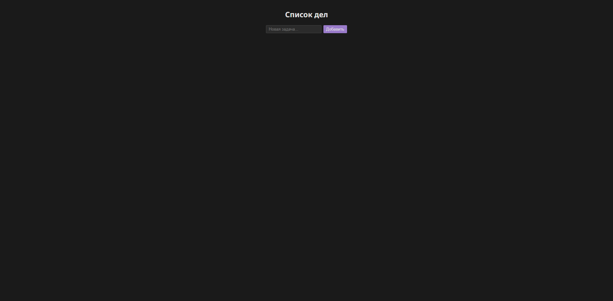

# To-Do-List-App

A simple task manager built with vanilla JavaScript.

🔗 **Live demo:** https://programerit12.github.io/homework/Lesson31/index.html

## Tech stack
HTML · CSS · JavaScript (no frameworks)

## Features
- Add new tasks via input field and "Add" button
- Mark tasks as completed
- Delete tasks
- Tasks are saved in localStorage, so they stay after page reload
- Dark theme UI

## What I practised
- DOM manipulation: creating, updating and removing elements
- Event handling (click, keydown)
- Working with arrays of objects
- Saving and loading data with localStorage